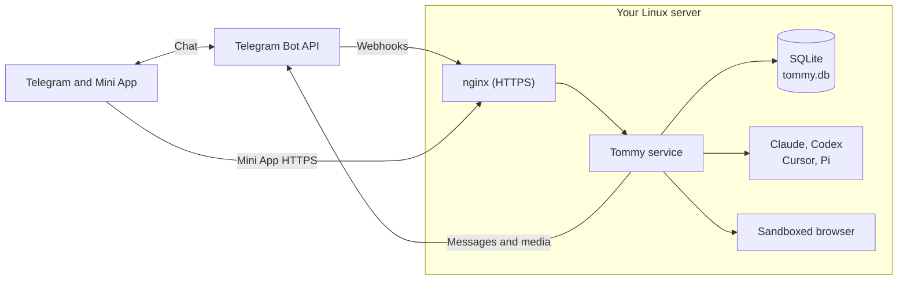

<div align="center">


# Tommy

**Your own crew of AI agents, on your own server, in Telegram.**

One server runs your agents day and night. You talk to them in Telegram: each agent is its own
Telegram bot, and a root agent answers in the manager chat. Telegram stores the messages and files
sent in its chats; the agents, their workspaces and the database stay on your server.

[](LICENSE)
[](https://github.com/nightly-labs/openbot)


[Install](#install) &nbsp;&bull;&nbsp; [Features](#features) &nbsp;&bull;&nbsp;
[Server](#server) &nbsp;&bull;&nbsp; [Development](#development) &nbsp;&bull;&nbsp;
[Built on OpenBot](#built-on-openbot)

</div>

> [!WARNING]
> Agents run with `danger-full-access`. They can read and modify files, run commands, use the
> network and control the embedded browser. Run only agents and tasks you trust.

## Install

**Let your coding agent install it.** Open Claude Code, Codex or another coding agent on the
computer that will be your server (or on a computer that can reach it over SSH), and paste this:

```text
Install Tommy for me. Read docs/INSTALL.md from this checkout, or get the guide from
https://raw.githubusercontent.com/jbaehova/tommy/main/docs/INSTALL.md if I use the main branch.
Follow it step by step. Ask me for every value it needs, such as my domain and my Telegram
manager bot. Show me each sudo command before you run it.
```

The agent checks the requirements, builds the server, sets up HTTPS and connects Telegram.

**What you need**

- A Linux server that stays on (Ubuntu 24.04 or Debian 12, 4 GB of memory or more), with a domain
  name that points to it and ports 80 and 443 open.
- At least one agent account: Claude, ChatGPT (Codex), Cursor or Pi.
- A Telegram account and a manager bot. Follow the [Telegram setup](docs/INSTALL.md#telegram-interface).

**Other ways**

- Install by hand: [docs/INSTALL.md](docs/INSTALL.md) is the same guide, written for people too.
- Download a build: [Releases](https://github.com/jbaehova/tommy/releases/latest) has the unpacked
  Linux server for x64 and arm64. The install steps above still apply.

## Features

- **Agents that stay.** Each agent has its own workspace, conversation, memory and identity. Switch
  it from Claude to Codex, restart the server, and it still knows who it is and what it was doing.
- **Your choice of model.** Run Claude, Codex, Cursor and Pi side by side. Tommy downloads and pins
  each provider CLI, so every agent gets a known-good runtime.
- **One chat per agent.** The manager bot is the chat of your root agent. `/connect` gives every
  other agent its own bot, and `/new` creates an agent with its bot and asks what it does. Answers come back formatted.
- **Agents that work together.** Agents hand work to each other inside Tommy. Each agent's chat
  shows the messages that it sent and received.
- **Browser and Computer Use.** Agents drive a sandboxed browser on the server. A password or code
  request opens a card inside the agent's chat, and `/browser` shows the agent's tabs. With
  [agent-desktop](https://github.com/vercel-labs/agent-desktop), agents also operate desktop apps.
- **Routines and workflows.** Schedule recurring work, chain steps into workflows, and trigger them
  from signed webhooks.
- **Skills and MCP.** Agents turn a workflow into a skill and share it from a local library with
  versions. MCP servers start by command or URL.

## How it works



The server is an Electron build run as a systemd service on a virtual display, so the agent
browser and Computer Use work without a screen. The SQLite database on the server is the source
of truth.

## Server

The server is installed by [docs/INSTALL.md](docs/INSTALL.md#1-server). Manage it with the `tommy`
command:

| Command | Purpose |
| --- | --- |
| `sudo tommy status` | Show the state of the server, the public listener and Telegram. |
| `sudo tommy logs` | Follow the log of the service. |
| `sudo tommy agents` | List the agents, and which have a Telegram chat. |
| `sudo tommy handoff --agent <name> --mode work < summary` | Give a session summary from another computer to an agent. Use `--mode record` to only keep it. The agent's chat shows the handoff and the answer. |
| `sudo tommy ask --agent <name> "question"` | Ask one agent a question and print its answer. The agent's chat shows it too. |
| `sudo tommy restart` | Restart the service. |

The app lives in `/opt/Tommy`, the data in `/var/lib/tommy`, and the settings in
`/etc/tommy/server.env`. To update, pull, build and run `tommy-install` again
([steps](docs/INSTALL.md#update-the-server-later)); the data stays.

nginx forwards the Telegram paths and the signed workflow webhooks to the loopback listener of
Tommy. Nothing else is public.

## Development

Development requires stable [Bun](https://bun.sh/) 1.4.2, Node.js 24 (the version in `.nvmrc`,
matching the Node that Electron bundles; run `nvm use`), and at least one supported agent CLI.

```bash
curl -fsSL https://bun.com/install | bash -s "bun-v1.4.2"
git clone https://github.com/jbaehova/tommy.git
cd tommy
bun install --frozen-lockfile
bun run build
```

Tommy runs as a Linux server. Test changes with the end-to-end scripts in `scripts/` and on a
server, not on your own computer: a development start uses the agent folders in your home folder.

| Command | Purpose |
| --- | --- |
| `bun run build` | Bundle the main process and the database host. |
| `bun run package:linux` | Build the unpacked Linux app that `tommy-install` installs. |
| `bun run typecheck` | Type-check every project. |
| `bun run lint` | Run Biome on the whole repository. `bun run format` also writes the fixes. |
| `bun run i18n:check` | Check the text catalogs. |
| `bun run test:changed` | Run the Vitest files that changed since `origin/main`. Also `test:related`, `test:backend` and `test:desktop`. |
| `bun run prepare:agent-desktop` | Stage the pinned Computer Use driver for this computer. Packages stage their own. |

| Path | Owns |
| --- | --- |
| `src/main` | The server lifecycle, the public listener, Telegram, and the services that the agents use. |
| `src/backend` | Provider adapters, persistence, message scheduling, transfers, and the browser host. |
| `scripts/hosting` | The Linux server install. |
| `packages/contracts` | Shared types, limits, and pure validation. |
| `packages/i18n` | The text that Tommy sends, in English and Korean. See [docs/i18n.md](docs/i18n.md). |

See [docs/ARCHITECTURE.md](docs/ARCHITECTURE.md) for dependency direction and state ownership, and
[CONTRIBUTING.md](CONTRIBUTING.md) before a security-sensitive change.

<details>
<summary><b>Local data</b></summary>

- `~/Tommy/Agents/<agent-id>`: one working directory per agent.
- `~/Tommy/Shared`: files intentionally shared between agents.
- `~/Tommy/Shared/Transfers`: managed message snapshots and generated files. Each transfer has an
  `.tommy-transfer.json` manifest with ownership, recipients, size, and SHA-256 metadata.
- `~/Tommy/Downloads`: embedded-browser downloads.
- Electron `userData/tommy.db`: the canonical event log and projections for agents, conversations,
  provider session bindings, queues, reactions, and attachment indexes.
- `provider-runtimes` in the app data folder: the provider CLIs Tommy downloads and pins.
- `~/.claude`, `~/.codex`, `~/.cursor`, `~/.pi`: login and session history, managed by each
  provider's own CLI.

Deleting an agent removes its workspace, owned generated attachments, and deliveries addressed only
to that agent. Tommy keeps one stable conversation when an agent changes provider.

</details>

## Built on OpenBot

<table>
<tr>
<td>

Tommy is a fork of **[OpenBot](https://github.com/nightly-labs/openbot)** by
[Synthetify Labs](https://openbot.run/), a local-first desktop workspace for persistent AI
teammates. The agent model, the provider adapters and the embedded browser come from OpenBot.
Thank you to its authors.

Tommy takes that base in a different direction: one always-on server that you own, used from
Telegram. Fixes from upstream are ported over time.

</td>
</tr>
</table>

| | OpenBot | Tommy |
| --- | --- | --- |
| **Shape** | Desktop app, local-first | One Linux server |
| **Interface** | The desktop app | Telegram: one bot per agent, and a Mini App for private input |
| **Accounts** | Optional OpenBot accounts | None: the server has one owner |
| **Providers** | Codex, Claude, Grok, Gemini, Cursor and many more | Claude, Codex, Cursor, Pi |
| **Computer Use** | `cua-driver` | [`agent-desktop`](https://github.com/vercel-labs/agent-desktop) |
| **Platforms** | macOS, Windows, Linux | Linux server |

## License and attribution

Licensed under the [PolyForm Noncommercial License 1.0.0](LICENSE), for noncommercial purposes only.
Commercial use needs a separate license from the copyright owner. See [NOTICE](NOTICE) for the
origin of this software and for third-party notices.
