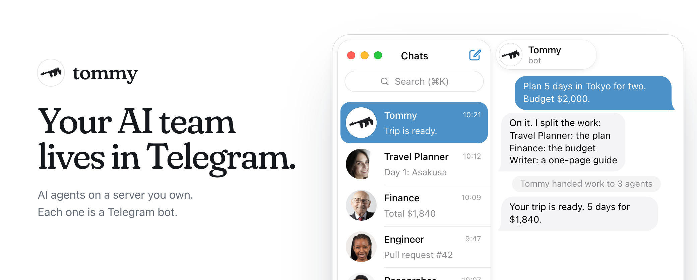
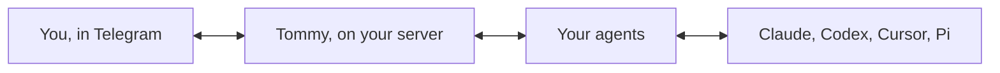

<div align="center">

<a href="https://jbaehova.github.io/tommy/"></a>

**Tommy runs a team of AI agents on your own server. You talk to them in Telegram.**

[](LICENSE)


[Website](https://jbaehova.github.io/tommy/) &nbsp;&nbsp; [Install](#install) &nbsp;&nbsp;
[Use it](#use-it) &nbsp;&nbsp; [How it works](#how-it-works) &nbsp;&nbsp; [Development](docs/DEVELOPMENT.md)

</div>

> [!WARNING]
> Agents run with `danger-full-access`. They can read and modify files, run commands, use the
> network and control the embedded browser. Run only agents and tasks you trust.

## How it works

Every agent is a Telegram bot. The first bot you make is the manager: in its chat, your root agent
answers. Ask it for anything, and it hands each part of the job to the agent that fits.

```text
You:     Plan a 5-day trip to Tokyo for two. Budget $2,000.
Tommy:   On it. Travel Planner makes the plan, Finance checks the budget,
         Writer turns it into a guide.
         ...
Tommy:   Your trip is ready. 5 days for $1,840. The guide is attached.
```

1. **You ask** in the manager chat, in plain words.
2. **The root agent splits the work** and sends each part to another agent.
3. **Each agent works on your server**, with its own workspace, memory and browser.
4. **You get one answer.** Each agent's chat shows the messages that it sent and received.



Telegram stores the messages and files sent in its chats. The agents, their workspaces, the
conversations and the database stay on your server.

### When a site asks for a password

Each agent has a private browser on your server. When a page asks for a password or a code, the
agent's chat shows an **Open Tommy** button. Enter the value in the private Mini App form. The
server delivers it to the page. Use `/browser` to see a screenshot when the page allows capture.
A step that needs you to click inside the site ends with a notice in the chat.

When an MCP service needs authorization, tap **Connect** in the chat that requested it. Open the
provider from the Mini App and sign in there. Tommy sends the result to the same chat.

## Install

**Let your coding agent install it.** Open Claude Code, Codex or another coding agent on the
computer that will be your server (or on a computer that can reach it over SSH), and paste this:

```text
Install Tommy for me. Read docs/INSTALL.md from this checkout, or get the guide from
https://raw.githubusercontent.com/jbaehova/tommy/main/docs/INSTALL.md if I use the main branch.
Follow it step by step. Ask me for every value it needs, such as my domain and my Telegram
manager bot. Show me each sudo command before you run it.
```

The agent checks the requirements, builds the server, sets up HTTPS and connects Telegram.

**What you need**

- A Linux server that stays on (Ubuntu 24.04 or Debian 12, 4 GB of memory or more), with a domain
  name that points to it and ports 80 and 443 open.
- At least one agent account: Claude, ChatGPT (Codex), Cursor or Pi.
- A Telegram account and a manager bot. Follow the [Telegram setup](docs/INSTALL.md#telegram-interface).

**Other ways**

- Install by hand: [docs/INSTALL.md](docs/INSTALL.md) is the same guide, written for people too.
- Download a build: [Releases](https://github.com/jbaehova/tommy/releases/latest) has the unpacked
  Linux server for x64 and arm64. The install steps above still apply.

## Use it

Talk to your agents in plain words. Commands are shortcuts: type `/` in a chat to see all of them.

**In the manager chat**

| Command | What it does |
| --- | --- |
| `/new <what the agent does>` | Create an agent with its own bot. Without the text, the manager asks for the role. |
| `/connect` | Give an existing agent its own bot. |
| `/agents` | List your agents and their chats. |
| `/root` | Choose the agent that answers in the manager chat. |
| `/disconnect @username` | Unlink a bot. The agent and its work stay on the server. |
| `/delete <agent name>` | Delete an agent that has no chat. |

**In an agent's chat**

| Command | What it does |
| --- | --- |
| `/model`, `/effort` | Change the model and its reasoning level. |
| `/engine codex` | Move the agent to Codex or Claude. It keeps its workspace and memory. |
| `/name <display name>` | Rename the agent. |
| `/instructions` | Show or change what the agent does. |
| `/routines` | Show or change the work that runs on a schedule. |
| `/memory`, `/history`, `/usage` | Show what the agent remembers and what all agents share, its recent messages, and plan usage. |
| `/status` | Show the agent's settings and state. |
| `/delete` | Delete the agent with its conversation and workspace. |

`/browser` shows an agent's browser tabs, and `/stop` stops the current task. Both work in the
manager chat and in each agent's chat.

### Server

Manage the server with the `tommy` command:

| Command | Purpose |
| --- | --- |
| `sudo tommy status` | Show the state of the server, the public listener and Telegram. |
| `sudo tommy logs` | Follow the log of the service. |
| `sudo tommy agents` | List the agents, and which have a Telegram chat. |
| `sudo tommy handoff --agent <name> --mode work < summary` | Give a session summary from another computer to an agent. Use `--mode record` to only keep it. The agent's chat shows the handoff and the answer. |
| `sudo tommy ask --agent <name> "question"` | Ask one agent a question and print its answer. The agent's chat shows it too. |
| `sudo tommy t3 link --name <name> <address>` | Link T3 Code on another computer, so agents can start, read and message its sessions. `sudo tommy t3` lists the links. See [T3 Code](docs/t3-code.md). |
| `sudo tommy restart` | Restart the service. |

A coding agent on another computer, such as a T3 Code session, can ask an agent or hand off its
session with `scripts/remote/install` ([T3 Code](docs/t3-code.md#t3-code-to-tommy)).

The app lives in `/opt/Tommy`, the data in `/var/lib/tommy`, and the settings in
`/etc/tommy/server.env`. To update, pull, build and run `tommy-install` again
([steps](docs/INSTALL.md#update-the-server-later)); the data stays.

## Features

- **Agents that stay.** Each agent has its own workspace, conversation, memory and identity. Switch
  it from Claude to Codex, restart the server, and it still knows who it is and what it was doing.
- **Agents that tell each other.** An agent passes a new fact on to the teammate that owns the
  topic, and facts about you that every agent needs go into a memory that all of them share.
- **Your choice of model.** Run Claude, Codex, Cursor and Pi side by side. Tommy downloads and pins
  each provider CLI, so every agent gets a known-good runtime.
- **Agents that work together.** Agents hand work to each other inside Tommy, and answers come back
  formatted. An HTML result can include a preview image and the original file.
- **You see long work.** During a long task, one status message says what the agent does now. It
  changes in place and goes away when the answer comes.
- **Browser and Computer Use.** Agents drive a sandboxed browser on the server. You see its screen
  and answer a password or code request in a Mini App inside Telegram. With
  [agent-desktop](https://github.com/vercel-labs/agent-desktop), agents also operate desktop apps.
- **Routines and workflows.** Schedule recurring work, chain steps into workflows, and trigger them
  from signed webhooks.
- **Skills and MCP.** Agents turn a workflow into a skill and share it from a local library with
  versions. MCP servers start by command or URL.

## Development

See [docs/DEVELOPMENT.md](docs/DEVELOPMENT.md) for the setup, the commands, the code layout, the
server internals and the local data. Read [CONTRIBUTING.md](CONTRIBUTING.md) before a change.

## License and attribution

Tommy is based on [OpenBot](https://github.com/nightly-labs/openbot) by Synthetify Labs.

Licensed under the [PolyForm Noncommercial License 1.0.0](LICENSE), for noncommercial purposes only.
Commercial use needs a separate license from the copyright owner. See [NOTICE](NOTICE) for the
origin of this software and for third-party notices. The example avatars on the banner and the
website come from Pexels; see [site/CREDITS.md](site/CREDITS.md).
