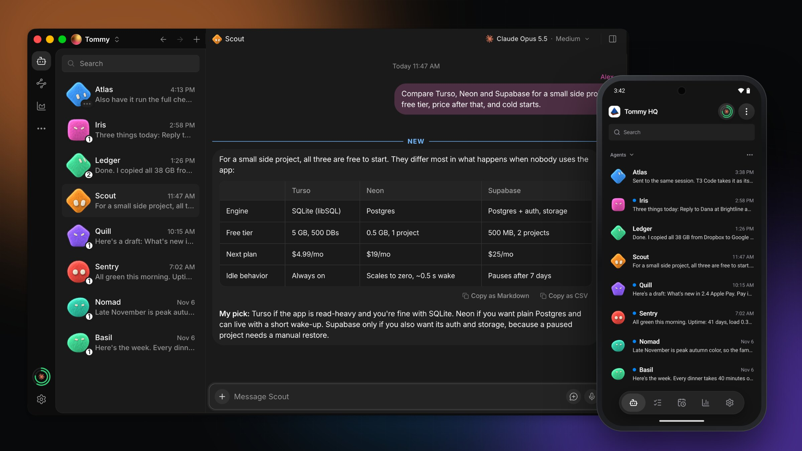
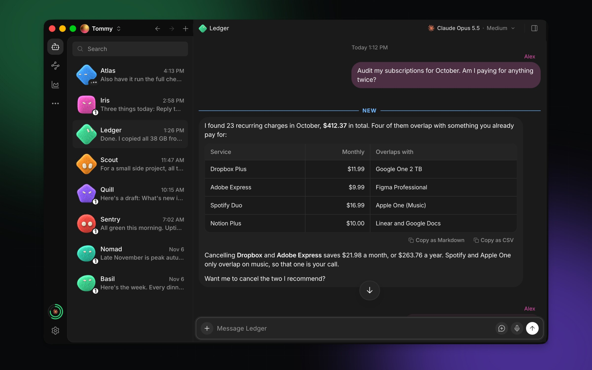
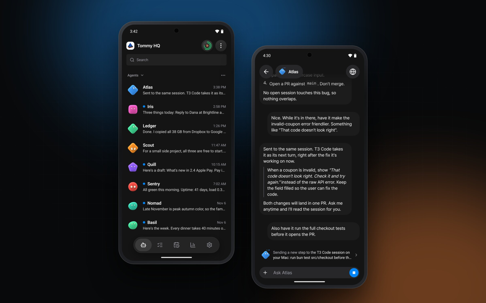
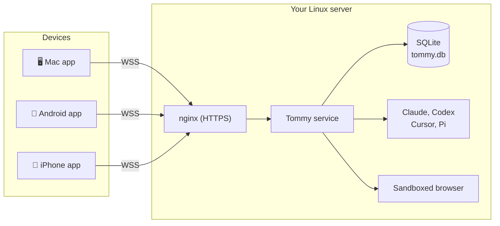

<div align="center">


# Tommy

**Your own crew of AI agents, on your own server, in your pocket.**

One server runs your agents day and night. The Mac, Android and iPhone apps connect to it directly.
No relay, no account service, no cloud copy of your chats.

[](LICENSE)
[](https://github.com/nightly-labs/openbot)


[Install](#install) &nbsp;&bull;&nbsp; [Features](#features) &nbsp;&bull;&nbsp;
[Screenshots](#screenshots) &nbsp;&bull;&nbsp; [Server](#server) &nbsp;&bull;&nbsp;
[Development](#development) &nbsp;&bull;&nbsp; [Built on OpenBot](#built-on-openbot)

<br>



</div>

> [!WARNING]
> Agents run with `danger-full-access`. They can read and modify files, run commands, use the
> network and control the embedded browser. Run only agents and tasks you trust.

## Install

**Let your coding agent install it.** Open Claude Code, Codex or another coding agent on the
computer that will be your server (or on a computer that can reach it over SSH), and paste this:

```text
Install Tommy for me. Read
https://raw.githubusercontent.com/jbaehova/tommy/main/docs/INSTALL.md
and follow it step by step. First ask me which parts to install (server, Mac app, Android app, iPhone app)
and for every value it needs, such as my domain. Show me each sudo command before you run it.
```

The agent checks the requirements, builds and installs the server, sets up HTTPS, installs the apps
and pairs them. It asks you before it changes the system. You can talk to it in any language.

**What you need**

- A Linux server that stays on (Ubuntu 24.04 or Debian 12, 4 GB of memory or more), with a domain
  name that points to it and ports 80 and 443 open.
- At least one agent account: Claude, ChatGPT (Codex), Cursor or Pi.
- For the apps: a Mac with Apple Silicon and macOS 13 or later, an Android phone, or an iPhone. The
  iPhone app is built on a Mac with Xcode and needs an Apple Developer Program membership.

**Other ways**

- Install by hand: [docs/INSTALL.md](docs/INSTALL.md) is the same guide, written for people too.
- Download the apps: [Releases](https://github.com/jbaehova/tommy/releases/latest) has the Mac app
  (signed and notarized) and the Android APK. The iPhone app has no download: build it from the
  guide. The server still needs the install steps above.

## Features

<table>
<tr>
<td width="50%" valign="top">

### 🧠 Agents that stay

Each agent has its own workspace, conversation, memory and identity. Switch it from Claude to Codex,
restart the server, and it still knows who it is and what it was doing.

</td>
<td width="50%" valign="top">

### 🔌 Your choice of model

Run **Claude**, **Codex**, **Cursor** and **Pi** side by side. Tommy downloads and pins each
provider CLI, so every agent gets a known-good runtime.

</td>
</tr>
<tr>
<td valign="top">

### 📡 Direct, private connection

Pair a device with a one-time code or QR code. The apps talk to your server over WSS, with no
relay in between. Your workspaces, chats and files stay on the server.

</td>
<td valign="top">

### 📱 Mac, Android and iPhone apps

A full desktop client for the Mac, and Android and iPhone apps with push notifications, tasks,
routines and usage. Start a job at your desk and check on it from the bus.

</td>
</tr>
<tr>
<td valign="top">

### 🌐 Browser and Computer Use

Agents open, read and drive a sandboxed embedded browser. With
[agent-desktop](https://github.com/vercel-labs/agent-desktop), they can also operate desktop apps
through the accessibility tree.

</td>
<td valign="top">

### ⏰ Routines and workflows

Schedule recurring work, chain steps into workflows, and trigger them from webhooks. Quiet runs
stay quiet; failures tell you.

</td>
</tr>
<tr>
<td valign="top">

### 🧩 Skills and MCP

Ask an agent to turn a workflow into a skill, then share it with the others from a local library
with versions. Add MCP servers by command or URL.

</td>
<td valign="top">

### 🤝 Agents that work together

Agents send each other messages, replies, reactions and managed file transfers, and hand work to
the right teammate.

</td>
</tr>
</table>

## Screenshots

<div align="center">



<sub><b>Mac.</b> Every agent in one sidebar, rich answers with tables you can copy as Markdown or CSV.</sub>

<br><br>



<sub><b>Android.</b> The same agents and chats, with push notifications.</sub>

</div>

<sub>Screenshots use demo agents and demo data.</sub>

## How it works



The server is the Linux build of the desktop app, run as a systemd service on a virtual display.
The SQLite database on the server is the source of truth. A signed-in phone keeps only an encrypted
read-only cache, deleted on sign-out.

## Server

The server is installed by [docs/INSTALL.md](docs/INSTALL.md#1-server). Manage it with the `tommy`
command:

| Command | Purpose |
| --- | --- |
| `sudo tommy status` | Show the state of the server. |
| `sudo tommy pair` | Show a one-time code and a QR code that pair a new device. |
| `sudo tommy devices` | List the paired devices. `revoke-device <id>` removes one. |
| `sudo tommy logs` | Follow the log of the service. |
| `sudo tommy restart` | Restart the service. |

The app lives in `/opt/Tommy`, the data in `/var/lib/tommy`, and the public address in
`/etc/tommy/server.env`. To update, pull, build and run `tommy-install` again
([steps](docs/INSTALL.md#update-the-server-later)); the data and paired devices stay.

Devices reach the server over HTTPS. `scripts/hosting/nginx-tommy.conf` forwards only the pairing
and connection paths to loopback; the Team API stays on loopback with no public path.

## Development

Development requires stable [Bun](https://bun.sh/) 1.4.2, Node.js 24 (the version in `.nvmrc`,
matching the Node that Electron bundles; run `nvm use`), and at least one supported agent CLI.

```bash
curl -fsSL https://bun.com/install | bash -s "bun-v1.4.2"
git clone https://github.com/jbaehova/tommy.git
cd tommy
bun install --frozen-lockfile
bun run dev
```

On macOS, a worktree's `node_modules` uses almost no new disk space. Bun clones packages from its
cache, and the root `postinstall` clones Electron from `~/Library/Caches/Tommy/electron-dist`.
`du` still shows the full size of each clone. Delete the directory to clear the cache; an entry that
nobody used for 30 days is removed by the next save.

Optional build settings go in the root `.env`; [.env.example](.env.example) lists them:

- `RENDERER_VITE_DEFAULT_SERVER_ADDRESS` fills the server field of the Mac pairing screen.
- `TOMMY_ANDROID_KEYSTORE` names the Android signing key, kept outside the repository (`~/` is the
  home folder). Keep the same key for every build, or the phone refuses the next build as an update.
- `FIREBASE_ANDROID_API_KEY`, `FIREBASE_ANDROID_APP_ID`, `FIREBASE_PROJECT_ID`,
  `FIREBASE_PROJECT_NUMBER` and `FIREBASE_STORAGE_BUCKET` come from your own Firebase project.
  Without them the Android app works but gets no notifications.
- `TOMMY_IOS_BUNDLE_ID` and `TOMMY_APPLE_TEAM_ID` are the bundle ID and the Apple team of an iPhone
  build. A simulator build needs neither.

<details>
<summary><b>All commands</b></summary>

| Command | Purpose |
| --- | --- |
| `bun run dev` | Start the Electron client with renderer HMR. Each worktree opens a profile of its own, keyed to its path; `--shared` opens the shared `Tommy Dev` profile instead. Ports come from the dev registry, so a sibling worktree never takes one this stack won. It refuses a second stack in the same worktree unless you pass `--force`. Before it starts, it runs `bun install --frozen-lockfile` only when `bun.lock`, a workspace `package.json` or a patch changed since the last successful run. |
| `bun run dev:status` | Show the dev stacks of this computer and their ports. |
| `bun run dev:stop` | Stop the processes that this worktree's stack started. Never stop a stack with `pkill -f electron` or `pkill -f bun`: on a machine running several worktrees those kill the other checkouts' work mid-write. |
| `bun run dev:forget` | Remove a stale entry from the dev registry. |
| `bun run dev:automation` | Drive a running dev app through CDP. Prints its usage with `--help`. |
| `bun run mobile` | Start the Expo development server for the phone apps. `mobile:android` installs a development build on a connected device, and `mobile:android:apk` builds the release APK. `mobile:ios:prebuild` makes the Xcode project, and `mobile:ios` builds and installs the iPhone app on a simulator or, with `--device`, on a connected iPhone. |
| `bun run package` | Build the Mac app into `dist/mac-arm64`. `dist:mac` also makes the DMG. |
| `bun run typecheck` | Type-check every project. |
| `bun run lint` | Run Biome on the whole repository. `bun run format` also writes the fixes. |
| `bun run check:ui` | Check the UI foundation rules. |
| `bun run i18n:check` | Check the interface text catalogs. |
| `bun run verify:preload` | Check the built preload bundle. |
| `bun run test:changed` | Run the Vitest files that changed since `origin/main`. Also `test:related`, `test:backend` and `test:desktop`. |
| `bun run package:linux` | Build the unpacked Linux app that `tommy-install` installs. `dist:linux` builds an AppImage. |
| `bun run prepare:agent-desktop` | Stage the pinned Computer Use driver for this computer, for a dev build. Packages stage their own. |

</details>

### Architecture

```text
Electron main
├── provider CLIs (Claude, Codex, Cursor, Pi) as child processes
├── SQLite command log and read projections
├── secure typed IPC handlers
├── direct connection server for paired devices
└── sandboxed WebContentsView browser host
    ↕ typed preload bridge
SolidJS renderer
```

| Path | Owns |
| --- | --- |
| `src/main` | Electron lifecycle, window security, local protocol, and IPC registration. |
| `src/backend` | Provider adapters, persistence, message scheduling, transfers, and the browser host. |
| `src/preload` | The typed `window.tommy` API, and nothing more. |
| `src/renderer` | The SolidJS interface. |
| `apps/mobile` | The Android and iPhone app (Expo). |
| `scripts/hosting` | The Linux server install. |
| `packages/contracts` | Process-boundary contracts, shared limits, and pure validation. |
| `packages/i18n` | The interface text in English and Korean. See [docs/i18n.md](docs/i18n.md). |

See [docs/ARCHITECTURE.md](docs/ARCHITECTURE.md) for dependency direction, state ownership, and
rules for new modules, and [CONTRIBUTING.md](CONTRIBUTING.md) before a security-sensitive change.

## Reference

<details>
<summary><b>Local skills</b></summary>

Ask an agent to create a skill from a reusable workflow. It prepares a folder with `SKILL.md` and
calls `create_skill`. The skill is saved in a shared local library and enabled for that agent. Other
agents can add it through **Settings → Skills → Local skills**.

Agents can use `list_local_skills`, `read_local_skill`, `revise_skill`, and `install_local_skill`.
Revisions require the version read by the agent and retain previous versions. Updating a library
skill does not update installed copies: use the Update chip or install an exact revision. Modified
installed files are protected.

Optional scripts, references, and assets follow the Codex skill folder structure. A PNG at
`assets/icon.png` supplies the local preview logo. The built-in `tommy-skill-creator` guide explains
the format and validation limits. Registration does not run scripts.

Skill authors can add optional `example-prompt` text to the YAML frontmatter in `SKILL.md`. The
skill preview shows it, and **Try skill** puts it in the selected agent's draft without sending it.

MCP servers are added in **Server settings → MCP**: a command (stdio) or a URL, with headers or a
browser sign-in.

</details>

<details>
<summary><b>Chat attachments</b></summary>

Attach MP3 audio and MOV or MP4 video through the file picker or drag and drop. The limits are
100 MB per file, 250 MB per message, and 10 files per message. Tommy gives the agent the original
file; it does not play, decode, transcribe, or validate the recording. For other formats, export as
MP3, MOV, or MP4, or attach a text transcript.

ZIP archives use the same limits. Tommy does not extract or inspect an archive: the agent extracts
it with its own tools, and sends one back with `tommy.attach_files_to_response`.

SVG images use the same limits. The chat shows an SVG as an image, but the agent gets it as a file,
because providers take only raster images.

</details>

<details>
<summary><b>Local data</b></summary>

- `~/Tommy/Agents/<agent-id>`: one working directory per agent.
- `~/Tommy/Shared`: files intentionally shared between agents.
- `~/Tommy/Shared/Transfers`: managed message snapshots and generated files. Each transfer has an
  `.tommy-transfer.json` manifest with ownership, recipients, size, and SHA-256 metadata.
- `~/Tommy/Downloads`: embedded-browser downloads.
- Electron `userData/tommy.db`: the canonical event log and projections for agents, conversations,
  provider session bindings, queues, reactions, and attachment indexes.
- `provider-runtimes` in the app data folder: the provider CLIs Tommy downloads and pins, one store
  for the whole computer.
- `~/.claude`, `~/.codex`, `~/.cursor`, `~/.pi`: login and session history, managed by each
  provider's own CLI.

Deleting an agent removes its workspace, owned generated attachments, and deliveries addressed only
to that agent. Tommy keeps one stable conversation when an agent changes provider. Native provider
session identifiers stay private and are used only to resume provider runtime state.

The renderer is never exposed as a public website. The embedded browser uses a separate sandboxed
Electron session and cannot access `window.tommy` or managed local attachments.

</details>

## Built on OpenBot

<table>
<tr>
<td>

Tommy is a fork of **[OpenBot](https://github.com/nightly-labs/openbot)** by
[Synthetify Labs](https://openbot.run/), a local-first desktop workspace for persistent AI
teammates. The agent model, the provider adapters, the embedded browser and much of the interface
come from OpenBot. Thank you to its authors.

Tommy takes that base in a different direction: one always-on server that you own, with thin
clients that connect to it directly. Fixes from upstream are ported over time.

</td>
</tr>
</table>

| | OpenBot | Tommy |
| --- | --- | --- |
| **Shape** | Desktop app, local-first | One Linux server, with Mac, Android and iPhone clients |
| **Connection** | Runs on your computer | Devices pair with a QR code and connect over WSS, no relay |
| **Accounts** | Optional OpenBot accounts | None: pairing is between your device and your server |
| **Providers** | Codex, Claude, Grok, Gemini, Cursor and many more | Claude, Codex, Cursor, Pi |
| **Computer Use** | `cua-driver` | [`agent-desktop`](https://github.com/vercel-labs/agent-desktop) |
| **Platforms** | macOS, Windows, Linux | Linux server, macOS client, Android and iPhone clients |

## License and attribution

Licensed under the [PolyForm Noncommercial License 1.0.0](LICENSE), for noncommercial purposes only.
Commercial use needs a separate license from the copyright owner. See [NOTICE](NOTICE) for the
origin of this software and for third-party notices.
