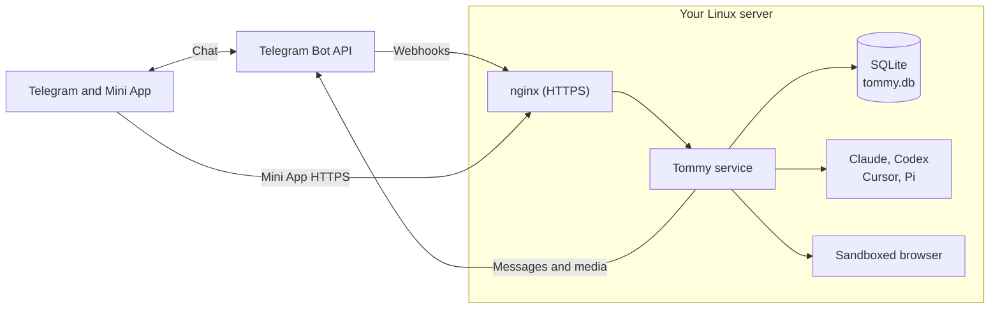

# Development

This page is for people who change Tommy. To install and use it, see the [README](../README.md).

## Setup

Development requires stable [Bun](https://bun.sh/) 1.4.2, Node.js 24 (the version in `.nvmrc`,
matching the Node that Electron bundles; run `nvm use`), and at least one supported agent CLI.

```bash
curl -fsSL https://bun.com/install | bash -s "bun-v1.4.2"
git clone https://github.com/jbaehova/tommy.git
cd tommy
bun install --frozen-lockfile
bun run build
```

Tommy runs as a Linux server. Test changes with the end-to-end scripts in `scripts/` and on a
server, not on your own computer: a development start uses the agent folders in your home folder.

## Commands

| Command | Purpose |
| --- | --- |
| `bun run build` | Bundle the main process and the database host. |
| `bun run package:linux` | Build the unpacked Linux app that `tommy-install` installs. |
| `bun run typecheck` | Type-check every project. |
| `bun run lint` | Run Biome on the whole repository. `bun run format` also writes the fixes. |
| `bun run i18n:check` | Check the text catalogs. |
| `bun run test:changed` | Run the Vitest files that changed since `origin/main`. Also `test:related`, `test:backend` and `test:desktop`. |
| `bun run prepare:agent-desktop` | Stage the pinned Computer Use driver for this computer. Packages stage their own. |

## Code layout

| Path | Owns |
| --- | --- |
| `src/main` | The server lifecycle, the public listener, Telegram, and the services that the agents use. |
| `src/backend` | Provider adapters, persistence, message scheduling, transfers, and the browser host. |
| `scripts/hosting` | The Linux server install. |
| `packages/contracts` | Shared types, limits, and pure validation. |
| `packages/i18n` | The text that Tommy sends, in English and Korean. See [i18n.md](i18n.md). |
| `site` | The landing page, published to GitHub Pages. |

See [ARCHITECTURE.md](ARCHITECTURE.md) for dependency direction and state ownership, and
[CONTRIBUTING.md](../CONTRIBUTING.md) before a security-sensitive change.

## Server internals



The server is an Electron build run as a systemd service on a virtual display, so the agent
browser and Computer Use work without a screen. The SQLite database on the server is the source
of truth.

nginx forwards the Telegram paths and the signed workflow webhooks to the loopback listener of
Tommy. Nothing else is public.

## Local data

- `~/Tommy/Agents/<agent-id>`: one working directory per agent.
- `~/Tommy/Shared`: files intentionally shared between agents.
- `~/Tommy/Shared/Transfers`: managed message snapshots and generated files. Each transfer has an
  `.tommy-transfer.json` manifest with ownership, recipients, size, and SHA-256 metadata.
- `~/Tommy/Downloads`: embedded-browser downloads.
- Electron `userData/tommy.db`: the canonical event log and projections for agents, conversations,
  provider session bindings, queues, reactions, and attachment indexes.
- `provider-runtimes` in the app data folder: the provider CLIs Tommy downloads and pins.
- `~/.claude`, `~/.codex`, `~/.cursor`, `~/.pi`: login and session history, managed by each
  provider's own CLI.

Deleting an agent removes its workspace, owned generated attachments, and deliveries addressed only
to that agent. Tommy keeps one stable conversation when an agent changes provider.

## Landing page and banner

`site/` is a static page with no build step. Open `site/index.html` in a browser to check it. The
`Pages` workflow publishes `site/` to GitHub Pages when a change to it reaches `main`.

`docs/assets/banner.png` (README) and `site/og.png` (link preview) are screenshots of
`docs/assets/banner.html`. Render that file with a headless browser at 1040x420 and at 1200x630,
both with a device scale factor of 2. The banner uses `site/style.css`, so render it again after a
change to the Telegram window. The example avatars and their licenses are listed in
[site/CREDITS.md](../site/CREDITS.md).

`site/browser.jpg`, the page in the agent's browser, is a screenshot of
`docs/assets/browser-example/index.html` at 1280x660 with a device scale factor of 1.

`docs/assets/logo.png` is the logo: the black mark on a white circle. `site/avatars/tommy.png` is the
same picture at 256 pixels.
